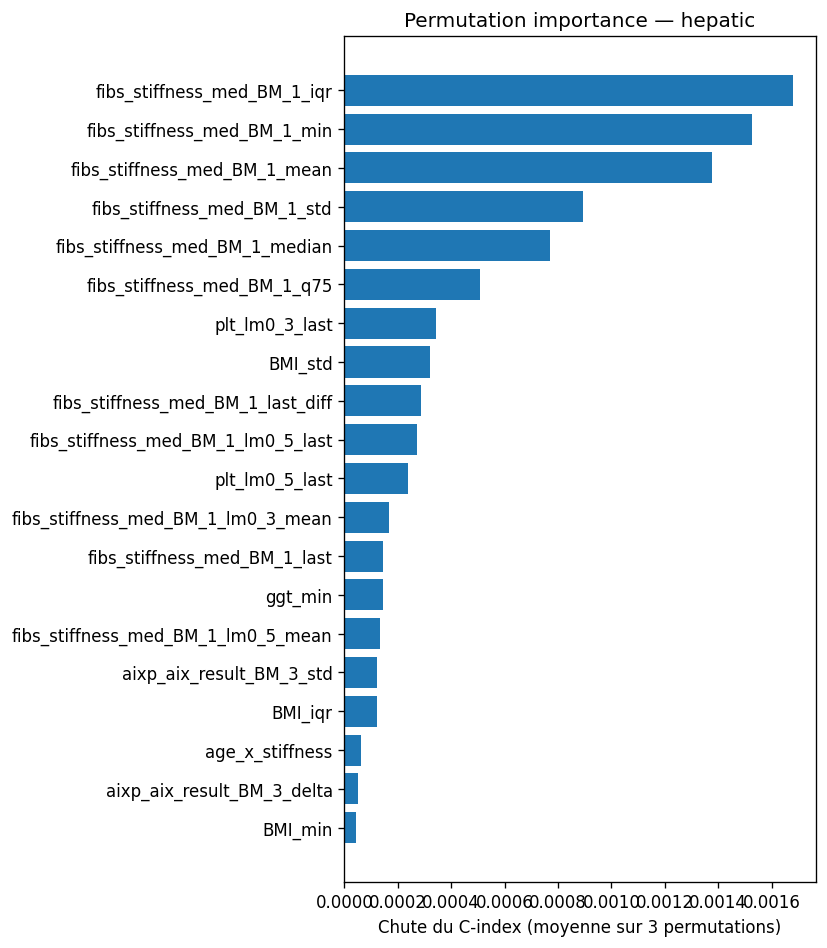

# ANNITIA Challenge 2026: risk stratification in MASLD

Survival models for patients with metabolic dysfunction-associated steatotic liver disease
(MASLD): rank patients by their risk of (1) a first major hepatic event and (2) death, from
repeated non-invasive tests and blood biomarkers. Challenge run by IHU ICAN, Trustii.io and the
French Health Data Hub, on synthetic data generated from hospital records. The score is a
weighted concordance index: 0.7 × hepatic + 0.3 × death.

**Result: public leaderboard C-index 0.9135**, and 0.929 with an artefact I found in the test
file (documented below).

## The data, and why it is hard

- 1,253 training patients and 423 test patients, up to 22 visits each, 11 longitudinal
  biomarkers (FibroScan stiffness, FibroTest, Aixplorer elastography, liver enzymes, platelets,
  lipids, glucose, BMI) and static risk factors (diabetes, hypertension, bariatric surgery).
- Events are rare: **47 hepatic events and 76 deaths**. One fold of the cross-validation holds
  about ten hepatic events, so fold scores move by several points (0.87 to 0.96 for the same
  model).
- Visits after an event are still in the training file, and the age columns encode the time of
  the event: both leak the target if used naively.

## Approach

1. **Targets** (`targets.py`): survival time from the first visit to the event or to the last
   observation, censoring otherwise.
2. **Leak prevention** (`features.py`, `leakage.py`): visits at or after the event age are masked
   before any aggregation; visit ages and the last observed age are never features. Six automatic
   checks stop the run if a target, an age column or a misaligned test column reaches the model.
3. **Features** (`features.py`): for each biomarker, statistics over the visits (last, first,
   mean, median, spread, slope, change, share of visits above a clinical threshold), over landmark
   windows, plus clinical scores computed at each visit (FIB-4, APRI, NFS, AST/ALT, GGT/platelets).
   365 features, of which 162 are kept for the hepatic endpoint by univariate concordance.
4. **Models** (`models.py`, `stacking.py`): gradient-boosted survival trees, XGBoost Cox, Coxnet
   and random survival forests, 5-fold cross-validation stratified on the event, 5 seeds, combined
   by a Cox meta-model on the out-of-fold ranks.
5. **Best submission without the test-order artefact** (`champion_v8.py`): gradient-boosted
   survival trees tuned on several configurations and averaged over 10 seeds, LightGBM
   classifiers at four horizons (5, 8, 11, 14 years) and Coxnet, blended on out-of-fold
   concordance, with follow-up features (see below).

## Results

How the public leaderboard score was built:

| Submission | Public leaderboard |
|---|---:|
| First gradient-boosted survival model | 0.873 |
| Tuned ensemble of survival models | 0.896 |
| + LightGBM at four horizons | 0.9128 |
| + blend with the ensemble of `champion_v8.py` (30%) | 0.9135 |
| + order of the test patients (an export artefact, see below) | 0.929 |

- **Follow-up features** (number of visits, follow-up duration, intervals between visits) are
  used from the tuned ensemble on. The challenge allows them, since the test file holds every
  visit; in clinical use they would not be known at prediction time (follow-up stops at death),
  which is why the documented pipeline keeps visit ages out.
- **Cross-validation:** the documented pipeline (`run_pipeline.py`, 5 seeds) reaches an
  out-of-fold C-index of 0.948 on the hepatic endpoint and 0.897 on death (weighted 0.933), a few
  points above the leaderboard because features are selected before the folds. The 0.9135
  submission blends `champion_v8.py` (30%) with the earlier LightGBM blend (70%).

**What drives the predictions** (permutation importance): FibroScan liver stiffness dominates
the hepatic endpoint (its spread, minimum and mean across visits), followed by platelets; age at
the first visit dominates mortality, followed by the BMI trend and fasting glucose. Both are
consistent with the clinical literature on MASLD.



## A leak in the test set

The test patients were not shuffled: their order (`trustii_id`) carries risk on its own, a
leaderboard score of 0.571 with no model at all. The same pattern exists in the training file,
mostly for mortality. Blending that order into the predictions raised the leaderboard to 0.929.
It is an artefact of how the synthetic data was exported, so the code here does not use it.

## Run

```bash
pip install -r requirements.txt
python -m src.run_pipeline     # documented pipeline -> outputs/submission.csv, cv_scores.json, importances
python -m src.champion_v8      # leaderboard ensemble -> outputs/submission_v8_*.csv
```

The challenge data (`train.csv`, `test.csv`, `dictionnary.csv`, `hello_world_submission.csv`)
comes from the Trustii platform and is not redistributed: put it in `data/`.
